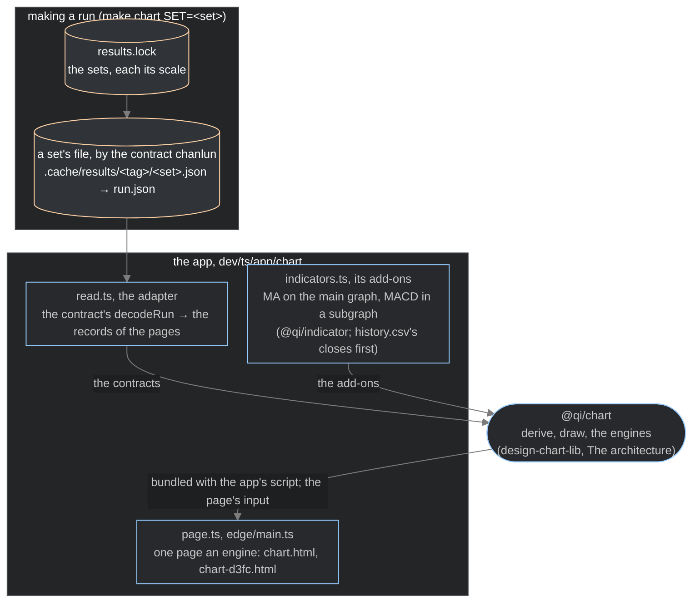

> Copied with `@qi/chart` and the chart app at version 1.8 (`docs/decisions.md`, 2026-10-28). It describes the code as copied, version 1.8, but for where the structure comes from, the published results (`docs/decisions.md`, 2026-11-01). Version 2 is written here.

# The chart app (2026-10-24)

It makes the chart pages from a run of the published results. What stands now of it. The library it draws with:
`design-chart-lib-2026-10-24.md`.

The app, `dev/ts/app/chart` (`make chart SET=<set>`, a set of the results made into a run and drawn; `make chart
DIR=…`, a run made already, drawn; its README, shipped in the flake package `chart`), reads the run into `@qi/chart`'s
contracts, draws them with both engines and writes one page an engine: `DIR/chart.html` (tv) and `DIR/chart-d3fc.html`
(d3fc).

## The results

What the app draws is the published product `chanlun-results`, pinned by `results.lock` at the root; it comes from
nowhere else, and the app knows nothing of what made it. A set is one file of the product, `<set>.json`, an asset of
the lock: the records of one run by 缠论's contract `chanlun` (`@qi/chanlun`, the flake input `contracts`): its K-lines
`klines`, merged bars `merged`, 分型 `fractals`, 笔 `strokes`, 线段 `segments`, and by level from 0 its 走势 `trends`
and 中枢 `centres`. `make results-fetch` (`dev/scripts/results.py`) takes the files of the image the lock names, by its
digest, with `crane`, into `.cache/results/<tag>/`, each checked against the lock's `sha256` and `size`: a file there
and right left alone, a wrong file stopping it by its name. The image is public: it needs no login, and no Docker.

A run holds no scale, source or title. A page's scale is the set's `scale` in `results.lock`; its source and its
default title are the set's name.

The records are used as they are: the library locates each extreme's K-line, as for any producer.

## Making a run (`make chart SET=<set>`)

The Makefile finds the set in `results.lock` by `dev/scripts/results.py`: a set the lock does not name, a set not
fetched (naming `make results-fetch`) and a file that is not the one the lock names each stop it. It runs the app's
command with `--results FILE --scale N`, into `.reports/charts/<set>-<LEVEL>/`, or `OUT=`, made again. The flake
package `chart` reads no lock: it is given the file and the scale on its command line, and the file's name
without `.json` is the set's name. The command writes `DIR/run.json`, the file as it is, and `DIR/meta.json`, the
scale, the source and the title, and then makes the pages.

With `INPUT= REQUEST= CHANLUN=none` instead (the command's `--input` and `--request`), a chart of bars alone: the
command reads the bars (`src/input.ts`), writes `in.csv` and `meta.json`, whose `"bars": true` keeps its pages drawn
again so, and makes the pages, its bars the x-axis and no structure: the run's bars, the app's own record
(`src/read.ts`, `runBarSchema`), given to `@qi/chart` as the market data's K-lines (`src/describe.ts`, `klinesOf`: each
an index from 0, its date in milliseconds, its prices as decimals at the scale, its volume as the run keeps it), which
the library makes the same bars (`docs/designs/design-chart-online-2026-11-08.md`, What changes for the chart app).
With `DIR=` instead (the command's `DIR` alone), it makes only the pages of a run already made, from `run.json` or
`in.csv` as its `meta.json` says.

With `ONLINE=N` too (the command's `--online N`), an online page of a run of bars alone: all but its last N K-lines, its
history, drawn whole by the library's batch; then, in the page, each of the last N given to its online component as
ongoing K-lines that reach its values and then the complete K-line, every quarter of a second, each change drawn by the
engine (`src/describe.ts`, `historyOf` and `comingFor`; `src/edge/browser.ts`). A change of the settings draws the
K-lines so far again. Its check: `make chart-online-check`, in `make chart-check`.

## Reading it into the contracts (`src/read.ts`)

The file is decoded by the contract's own `decodeRun`, never by a parser of this project: every record's rules and the
run's own with it (a line from a merged bar to a later one, a 中枢's ZD at most its ZG, every position a K-line's, …). A
file that breaks one is a fault of that file, not a drawing: the app's job, the library does not decode again.

Nothing of a record changes: the contract's date is already the position of its K-line on the x-axis, a date not set
absent, and each configuration after 包含 is already on its merged bars. The parts of the run are the pages':
`klines` the x-axis, `merged`, `fractals`, `strokes`, `segments` the 线段, and each level's `trends` and `centres`
one after another in the order of their levels, each record keeping its `level`.

Which K-line of a merged bar holds its extreme is not the app's: the library locates it, the same for every
configuration (`design-chart-lib-2026-10-24.md`, The DSL, layer 2).

## Known of the results

- The results date a line and a 中枢 by the last K-lines of their merged bars (`startBar` and `endBar`, a 中枢's `ggBar`
  and `ddBar`), and their `startRno`, `endRno`, `ggRno` and `ddRno` are 0. That last K-line need not hold the merged
  bar's extreme: on SPY 1m 2025-04-07 to 04-09, 65 of 390 分型; on SPY 1m 2024-10-03 to 2026-10-02, 108 of 1,008 中枢
  dates at level 0, 6 of 80 at level 1.
- Two 中枢 of SPY 5m 2024-10-03 to 2026-10-02 (level 0 and 1) give a DD, 565.49, that is not the low of the merged
  bar at their `ddDate` (2024-10-04 15:59, its low 572.75): the K-line of that low is 2024-10-03 13:04. A fault of the
  results; GG and DD are not drawn, so nothing is drawn wrong by it.
- The first merged bar's direction is the results' starting setting (up), not a 包含 result: where a bottom 分型 is
  on it (SPY 5m, SPY 1d, SH000001 1m 2007, of the runs looked at), the one map puts the mark at that bar's high. Every
  other 分型 of those runs, and all 64,593 of SPY 1m two years, is on a merged bar of its own direction.
- A 中枢's end and its GG (or DD) are those of the move that leaves it: the results count the leaving move in the
  中枢, so the next 中枢 starts at or before the last one's end, with no ±1 between (SPY 1m 2024-10-03 to 2026-10-02:
  116 of 251 pairs at level 0, 7 of 19 at level 1). Drawn as given: where a 中枢 ends, which 缠论's texts do not
  say, is the results' producer's to define. The app makes no correction of these ends (the old app's correction was
  retired with it, 2026-10-25).
- 4 of 561 走势 on the runs of `.reports/charts` end at a price not their end 分型's.
- The 笔 are known to have a subtle problem, still to be found.

## The pages (`src/page.ts`, `src/edge/main.ts`)

- A page's line of text says where its data came from: the set's name, and that the structure is the published
  results'; a chart of bars alone, the source its request gives.
- What a page carries (version 1.7, step 2, `design-chart-lib-2026-10-24.md`): its input (`src/describe.ts`: the
  components as read, the closes before the run, the scale, the title, the settings, the levels ticked at first) and
  the app's script (`src/edge/browser.ts`, bundled by Bun with `@qi/chart`, `@qi/indicator` and the add-ons), which
  makes the engine's description in the browser by the functions the command uses (`describe.ts`'s `components`, then
  `tvChart` or `d3fcChart`). The command makes the same description first, so a fault stops it, not the page.
  `src/edge/check-page.ts` runs a page's own script on its own input and compares (`make chart-page-check`; in
  `make chart-check`).
- `make chart DIR=… [LEVEL=all|0|1…]`: the levels ticked at first.
- 周期: the same bars at other periods, each run its own folder and pages; the app is given them all (`--periods
  NAME=DIR,…`, `src/periods.ts`) and writes them into each page as `PERIODS`, which the engine scripts offer as a
  pull-down. A period is the microscope's power, a way
  to view the market from macro to micro, not a level: the levels are the recursion's, grown on each series from its
  own level 0 (缠论's own words: 「级别，本质上与时间无关」), so one period's 中枢 say nothing of another's levels.
- 成交量分布 (the library's since version 1.5, `design-chart-lib-2026-10-24.md`): a price distribution over each 笔, each level's 线段 (level 0's the run's `segments`,
  level L's the 走势 of level L − 1) and each level's 中枢, over its K-lines (from its start merged bar's to its end
  merged bar's, by the library's one map), by `@qi/indicator`'s `profile` on the page's own bars: its parameter's rows (24 by default), or one a cent where the item spans fewer cents; the
  volumes whole. On SPY 1m 2024-10-03 to 2026-10-02 (194,490 K-lines): 12,169 笔, 1,644 + 141 + 8 + 1 线段, 252 + 20 +
  1 中枢; each page about 5.5 MB larger (47 MB for tv, 49 MB for d3fc). Its look is kept as
  faint as the volume. The rows outside the value
  area at half the volume's opacity, so the value area reads; the page's own bars, not finer ones inside a coarser
  bar (a 1m page has none finer, and reading a second run by time waits until a chart at a coarse period needs
  it).
- The add-ons (`src/indicators.ts`; `design-chart-lib-2026-10-24.md`, Components): the averages on the main graph,
  MACD in a subgraph under it, their values computed by the app with `@qi/indicator`, each its parameters and style
  the settings'. How they start: where the run's folder has `history.csv` (a run holds none: a file put in `DIR`),
  its closes come first, so the first K-line has its averages; where it has none (minute runs), from the first K-line,
  an MA with no value until it has its n closes, the EMAs starting at the first close.
- The settings (`src/settings.ts`; `chart.toml`, or another by `make chart CONFIG=FILE`; in a
  config file; `design-chart-lib-2026-10-24.md`, Version 1.7): how a run is shown, not what it is. Every value has its
  default in the code, the library's in `@qi/chart`, the app's in `settings.ts`; a file gives only what differs:
  `[chart.KEY.style]` (and `params`) for the library's components, `[chart.layout]` (the digits a price is shown to,
  2: the scale is how the prices are held and no longer sets them), the averages and MACD each `params` and `style`,
  `[picture]`. `make chart-settings` writes every value in the file's form. The colours they name are checked against
  the palette, and the file before a run is made. A chart with other values is a settings file of its own.

## The old app, retired (2026-10-25)

The first chart app is gone. What used it uses this app instead:

- `make chart` is this app's: a set drawn, or with `DIR=` the pages of a run made.
- The flake package `chart` runs this app (its README shipped); `make chart-check` and `make chart-package` check it.
- The old static picture is retired: it placed every result at its date, the results' fault; the library's TikZ
  engine replaces it (version 1.6, `make chart` with tikz in `ENGINE=`).
- The old outputs are dropped; its correction of where a 中枢 ends is not carried over.
