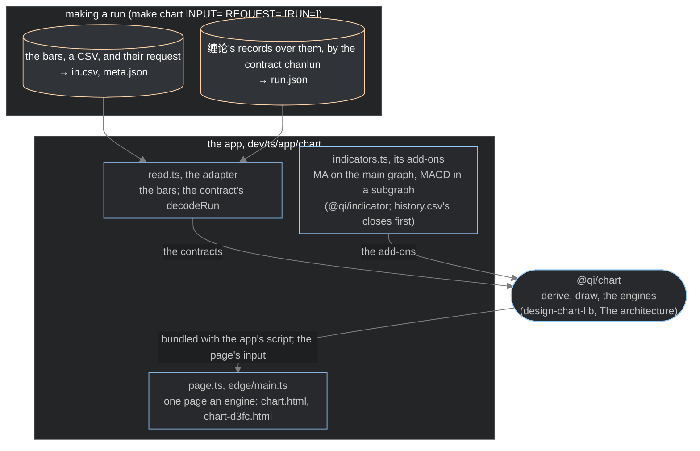

> Copied with `@qi/chart` and the chart app at version 1.8 (`docs/decisions.md`, 2026-10-28). It describes the code as it stands: its input, a run of bars and, beside them, a run of 缠论's contract `chanlun` 3.1.0 (`design-chart-chanlun-3-2026-11-09.md`, The chart app).

# The chart app (2026-10-24)

It makes the chart pages from a run of bars and, where it is given one, a run of 缠论's contract over them. What
stands now of it. The library it draws with: `design-chart-lib-2026-10-24.md`; the structure's records and how they
are drawn: `design-chart-chanlun-3-2026-11-09.md`.

The app, `dev/ts/app/chart` (`make chart INPUT= REQUEST= [RUN=]`, a run made and drawn; `make chart DIR=…`, a run made
already, drawn; its README, shipped in the flake package `chart`), reads the run into `@qi/chart`'s components, draws
them with both engines and writes one page an engine: `DIR/chart.html` (tv) and `DIR/chart-d3fc.html` (d3fc).

## Its input

The app takes a run of bars, a CSV of its own form (`src/input.ts`; its README, Its input) and their request (the
scale the prices are held at, a power of ten, and the source); and, beside them where there is one, a run of 缠论's
contract `chanlun` 3.1.0 over those bars (`run.json`), its positions the places of the bars, from 0. It takes no
published results: those on 3.1.0 name no K-lines they were made from, so no set of them can be drawn; results that
name their K-lines are taken by a design of their own when they are published. It knows nothing of what made a run.

The checks draw the test data's bars (`test/data/`) and the contract's own vectors in this form (`make vectors`,
`dev/scripts/vectors.ts`): `run.json` over the 4,000 bars its `bars.ts` makes up, taken from the flake input
`contracts` at its tag.

## Making a run (`make chart INPUT= REQUEST= [RUN=]`)

The command (`--input`, `--request`, and `--run` where there is one) reads the bars (`src/input.ts`) and writes
`DIR/in.csv` and `DIR/meta.json` (the scale, the source, the title where one is given, and `"run": true` with a run),
and with a run `DIR/run.json`, the file as it is; then it makes the pages. The bars are the x-axis: the run's bars,
the app's own record (`src/read.ts`, `runBarSchema`), given to `@qi/chart` as the market data's K-lines
(`src/describe.ts`, `klinesOf`: each an index from 0, its date in milliseconds, its prices as decimals at the scale,
its volume as the run keeps it), which the library makes the same bars (`docs/designs/design-chart-online-2026-11-08.md`,
What changes for the chart app). With `DIR=` instead (the command's `DIR` alone), it makes only the pages of a run
already made, from `in.csv` and, where its `meta.json` says so, `run.json`.

A window (`WINDOW=`, `LAST=`; the command's `--window`, `src/window.ts`) is of bars alone: the page given only its
K-lines, the closes before it first. With a run it is refused: a run of the contract numbers its merged bars by their
place in the whole, so a window would number every record again and cut the confirmations past its end.

With `ONLINE=N` too (the command's `--online N`), an online page of a run of bars alone: all but its last N K-lines, its
history, drawn whole by the library's batch; then, in the page, each of the last N given to its online component as
ongoing K-lines that reach its values and then the complete K-line, every quarter of a second, each change drawn by the
engine (`src/describe.ts`, `historyOf` and `comingFor`; `src/edge/browser.ts`). A change of the settings draws the
K-lines so far again. Its check: `make chart-online-check`, in `make chart-check`.

## Reading it into the contracts (`src/read.ts`)

The run's records are decoded by the contract's own `decodeRun`, never by a parser of this project: every record's
rules and the run's own with it (a line from a merged bar to a later one, a 中枢's ZD at most its ZG, every merged bar
a record names one of the run's, …). A file that breaks one is a fault of that file, not a drawing: the app's job. The
run is given to the library whole, as it is (`run`); a run of bars alone has a run of no record. The library checks the
run against the bars beside it (`located`), and draws its records as the contract reads them.

## The pages (`src/page.ts`, `src/edge/main.ts`)

- A page's line of text says where its data came from: the source its request gives, and with a run that 缠论's
  records are beside the bars (`run.json`).
- What a page carries (version 1.7, step 2, `design-chart-lib-2026-10-24.md`): its input (`src/describe.ts`: the
  components as read, the closes before the run, the scale, the title, the settings, the levels ticked at first) and
  the app's script (`src/edge/browser.ts`, bundled by Bun with `@qi/chart`, `@qi/indicator` and the add-ons), which
  makes the engine's description in the browser by the functions the command uses (`describe.ts`'s `components`, then
  `tvChart` or `d3fcChart`). The command makes the same description first, so a fault stops it, not the page.
  `src/edge/check-page.ts` runs a page's own script on its own input and compares (`make chart-page-check`; in
  `make chart-check`).
- `make chart DIR=… [LEVEL=all|0|1…]`: the levels ticked at first.
- 周期: the same bars at other periods, each run its own folder and pages; the app is given them all (`--periods
  NAME=DIR,…`, `src/periods.ts`) and writes them into each page as `PERIODS`, which the engine scripts offer as a
  pull-down. A period is the microscope's power, a way
  to view the market from macro to micro, not a level: the levels are the recursion's, grown on each series from its
  own level 0 (缠论's own words: 「级别，本质上与时间无关」), so one period's 中枢 say nothing of another's levels.
- 成交量分布 (the library's since version 1.5, `design-chart-lib-2026-10-24.md`): a price distribution over each 笔
  and each level's 线段, 走势 and 中枢, over its K-lines (from the K-line that represents its start merged bar to the
  one that represents its end merged bar, by the library's one map), by `@qi/indicator`'s `profile` on the page's own
  bars: its parameter's rows (24 by default), or one a cent where the item spans fewer cents; the volumes whole. Its
  look is kept as faint as the volume. The rows outside the value
  area at half the volume's opacity, so the value area reads; the page's own bars, not finer ones inside a coarser
  bar (a 1m page has none finer, and reading a second run by time waits until a chart at a coarse period needs
  it).
- The add-ons (`src/indicators.ts`; `design-chart-lib-2026-10-24.md`, Components): the averages on the main graph,
  MACD in a subgraph under it, their values computed by the app with `@qi/indicator`, each its parameters and style
  the settings'. How they start: where the run's folder has `history.csv` (a run holds none: a file put in `DIR`),
  its closes come first, so the first K-line has its averages; where it has none (minute runs), from the first K-line,
  an MA with no value until it has its n closes, the EMAs starting at the first close.
- The settings (`src/settings.ts`; `chart.toml`, or another by `make chart CONFIG=FILE`; in a
  config file; `design-chart-lib-2026-10-24.md`, Version 1.7): how a run is shown, not what it is. Every value has its
  default in the code, the library's in `@qi/chart`, the app's in `settings.ts`; a file gives only what differs:
  `[chart.KEY.style]` (and `params`) for the library's components, `[chart.layout]` (the digits a price is shown to,
  2: the scale is how the prices are held and no longer sets them), the averages and MACD each `params` and `style`,
  `[picture]`. `make chart-settings` writes every value in the file's form. The colours they name are checked against
  the palette, and the file before a run is made. A chart with other values is a settings file of its own.

## The old app, retired (2026-10-25)

The first chart app is gone. What used it uses this app instead:

- `make chart` is this app's: a run of bars drawn, or with `DIR=` the pages of a run made.
- The flake package `chart` runs this app (its README shipped); `make chart-check` and `make chart-package` check it.
- The old static picture is retired: it placed every result at its date, the results' fault; the library's TikZ
  engine replaces it (version 1.6, `make chart` with tikz in `ENGINE=`).
- The old outputs are dropped; its correction of where a 中枢 ends is not carried over.
