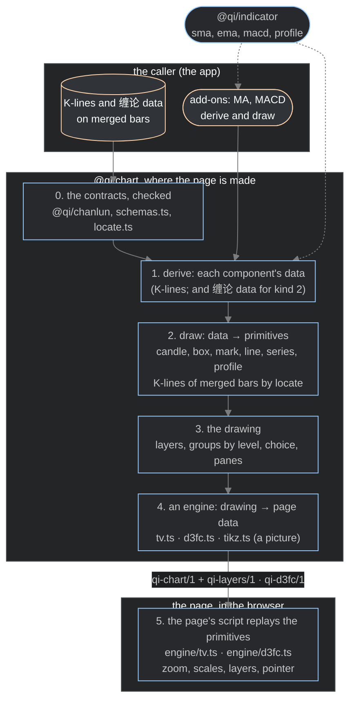

> Copied with `@qi/chart` and the chart app at version 1.8 (`docs/decisions.md`, 2026-10-28). It describes the code as copied, version 1.8. Version 2 is written here.

# @qi/chart: a 缠论 drawing library (2026-10-24)

It draws a K-line chart with the 缠论 structure on it (包含, 分型, 笔, 线段, 走势, 中枢, by level), with the volume
and the indicators, in more than one engine from one description. What stands now of it. The app that uses it:
`design-chart-app-2026-10-24.md`.

`@qi/chart` (`dev/ts/lib/chart`) takes its contracts and draws them. It knows nothing of where its data comes from,
computes no structure, tests no producer, and knows no K-line period; it does every computation its display needs
(The DSL). A caller gives it the components; whether their values are right by 缠论 is the caller's question.

## The architecture

The K-lines are the primary data; everything on a chart is derived from them. A chart is made in two places: where
the page is made (TypeScript, once), and in the browser (the page's script, as the reader zooms and points). The
library is everything between the caller's data and the page; it knows nothing of where the data comes from.

| Layer | Takes | Gives | Where | Runs |
|---|---|---|---|---|
| 0. the contracts | the caller's K-lines and 缠论 data, every configuration on merged bars | the components, checked (`located`) | `@qi/chanlun` (缠论's contract, `qi-v2-contracts`); `schemas.ts`, `locate.ts` | page made |
| 1. derive | the K-lines (kind 1), and the 缠论 data (kind 2) | each component's data | the library's own (`drawing.ts`, `distribution.ts`); the caller's add-ons (`addon.ts`) | page made |
| 2. draw | a component's data | the DSL's primitives (candle, box, mark, line, series, profile), in K-line positions and prices; a configuration's K-lines by the one map (`locate.ts`) | each drawing (`kline.ts` … `zhongshu.ts`, `profile.ts`); an add-on's own | page made |
| 3. the drawing | every component's primitives | the chart: its layers (a box each), its groups by level, its choice (成交量分布), its panes (the main graph, a subgraph each) | `drawing.ts`, `dsl.ts` | page made |
| 4. an engine | the drawing | its page data: tv, `qi-chart/1` and `qi-layers/1`; d3fc, `qi-d3fc/1`; tikz, a TikZ picture | `tv.ts`, `d3fc.ts`, `tikz.ts` | page made |
| 5. the page's script | the page data | the chart on the screen: zoom and pan, the price scales fitted to the view, the layers shown, the values under the pointer, 成交量分布 under the pointer | `engine/tv.js` (Lightweight Charts), `engine/d3fc.js` (D3, d3fc) | browser |

So a component's derive and draw run once, where the page is made; the browser only replays primitives. An indicator's
parameters are fixed in the page; other parameters mean the page made again.

The caller (`design-chart-app-2026-10-24.md`) gives layer 0 and its add-ons; `@qi/indicator` (`dev/ts/lib/indicator`)
computes indicators for whoever derives them: `sma`, `ema`, `macd` (as the Chinese screens draw it: DIFF, DEA,
2 × (DIFF − DEA)), and `profile`, a price distribution over a run of bars (each bar's volume spread over the rows its
low to high covers, by overlap; up and down apart; the point of control and the 70% value area). The app's add-ons
use the first three; the library's 成交量分布 uses `profile`.

## Components: derive and draw (built, version 1.5)

The K-lines are the primary data; everything else on a chart is derived from them. So every component of a chart is
two callbacks, with its place (the main graph, or a subgraph of its own):

- **derive**: its data, from what it is given;
- **draw**: that data composed of the DSL's primitives, given its pane (How it is built, below).

Its layer is its primitives': boxes and bars under the candles, lines and marks over them.

The library owns what is shared: the K-lines, the time axis, the panes, their price scales, the boxes to tick, and
calling the two callbacks.

There are two kinds of component, by what `derive` is given:

| Kind | `derive` is given | Public |
|---|---|---|
| 1 | the K-lines | yes: an add-on, both callbacks from its caller |
| 2 | the K-lines and the 缠论 data | no: the library's own |

Both kinds work the same way; the library's own components have their callbacks from inside it:

| Component | Kind | derive | draw |
|---|---|---|---|
| K-line, 成交量 | 1 | the library's | the library's |
| the 缠论 configurations (包含, 分型, 笔, 线段, 走势, 中枢) | the 缠论 data itself, which kind 2 is given | the producer's, from the caller (today the app's adapter, reading the results) | the library's, the DSL (below) |
| 成交量分布 | 2 | the library's | the library's |
| MA, MACD, any other indicator | 1 | the caller's (the app, with `@qi/indicator`) | the caller's |

A new indicator, a new form, a new subgraph is a new add-on of kind 1: the library does not change, but for a form no
primitive draws, which is a new primitive, every engine implementing it (a draw is composed of the DSL's primitives, so the engines stay as they are and TikZ draws it too).

### How it is built (version 1.5)

- **A draw is composed of primitives, at build time.** `draw` is a drawing like the library's own: given an engine's
  primitives (`Engine<R>`) and its place, it returns them, in K-line positions and prices. It runs where the page is
  made, in TypeScript; nothing of it runs in the browser, so nothing has to reach the page but the primitives, as
  today. The view (which K-lines are in view, the pixels, the pointer) stays the engines'.
- **An add-on** (`addon.ts`): `{ key, name, place, on, params, style, derive, draw }`, where `derive(xAxis, params)`
  gives its data from the K-lines and its parameters and `draw(e)(data, pane, style)` its primitives, in the pane it
  is given, in its style (Version 1.7). `place` is `"main"` or `"sub"`: the main graph, or a
  subgraph of its own under it, its pane given by the library in the order the add-ons come. The library calls both
  callbacks; the caller only gives the add-ons, in the components (`addons`).
- **The layer is the primitive's**: boxes and bars under the candles, lines and marks over them, as today; an add-on
  says no layer of its own.
- **The library's own components** are written the same way (the configurations' contracts untouched): K线 and
  成交量 of kind 1; each configuration of 缠论 a component whose derive takes its own from the 缠论 data and whose
  draw is its drawing (`baohan.ts` … `zhongshu.ts`); 成交量分布 of kind 2, a choice of layers, its derive moved from
  the app into the library (`distribution.ts`, by `@qi/indicator`'s `profile`) and its draw `profile.ts`, so the
  components no longer carry `profiles`. Kind 2 is not exported.
- **The page**: each add-on a box to tick, after 成交量; a subgraph a pane under the main graph, the layout's share of
  the main graph's height each (a quarter by default), its own price scale fitted to its values in view, labelled at the right, the time axis
  shared. The tv engine has panes already; the d3fc engine implements the `series` primitive's pane, which it had not.
  On the main graph the K-lines alone set the price scale in both engines (an average outside their range is cut).
- **MA and MACD, the first add-ons** (`dev/ts/app/chart/src/indicators.ts`): the averages of the closes on the main
  graph, each in its colour, and MACD in a subgraph, their parameters and style the app's settings (defaults in
  `settings.ts`: MA5, MA10, MA30 in `cl-ink`, `cl-center`, `cl-gap`; MACD(12,26,9)); DIFF and DEA lines (`cl-ink`,
  `cl-center`) and the MACD bars in the candles' colours by their sign; each value in the legend.
- **How they start**: where the run has `history.csv` (daily and monthly runs), its closes come first, so the first
  K-line has its averages; where it has none (minute runs), from the first K-line: an MA has no value until it has
  its n closes, and the EMAs start at the first close, as `@qi/indicator` defines them.

## The contracts

缠论's data are the records of 缠论's contract, `@qi/chanlun` (`chanlun-1.1.0` of `qi-v2-contracts`, its
`chanlun/SPEC.md`; the flake input `contracts`, linked at `dev/ts/node_modules/@qi/chanlun` by `make chanlun-link`;
they are not the chart's, and they chain, each step's output the next step's input: the K-line into 包含, the merged bar out of it and into 分型, and so on); the chart takes them as they are, through its `schemas.ts`, which holds its own: the x-axis and the price distribution. One a configuration: the x-axis (the K-lines in time order), the merged bar (包含),
the 分型, the line (笔, 线段, 走势; each with its level), the 中枢, and the price distribution. Every field the
producer gives is kept; a date is the position of its K-line on the x-axis (from 0), a date not set absent.

Beside them, the caller gives the chart's title, the prices' scale (how they are held, exactly) and its options
(Version 1.7), among them the layout's digits a price is shown to (`options.layout.digits`, 2 by default; every engine
writes every price to them, the axes, the legend, the pointer and the picture; how a run is
shown is the app's settings, not derived from the scale).

Every configuration after 包含 is on merged bars, by their number (`mno`):

- a merged bar: its number, its first and last K-lines, its high and low, its direction;
- a 分型: its merged bar (`mno`), a top (`ding`) or a bottom;
- a line: its start and end merged bars (`startBar`, `endBar`), up (`isUp`) or down;
- a 中枢: its start and end merged bars (`startBar`, `endBar`), the merged bars of its GG and DD (`ggBar`, `ddBar`).

Their rules, beside each field's: a 中枢's band within its range (DD ≤ ZD ≤ ZG ≤ GG); `located` takes the components
only where each merged bar's number is its own, its K-lines the x-axis' own, and every merged bar a configuration
names one of them with a K-line of its extreme. The page data's: margins that leave some height (top and bottom below
1 together), `qi-d3fc/1`'s times strictly increasing.

No configuration's contract carries the K-line of an extreme: the library locates it (The DSL, layer 2).

A price distribution (`profileSchema`) is an indicator's values, not a configuration: it is over the K-lines `from`
to `to` its caller computed it on (the app, by the library's one map), from `low`, rows of `step`, each its up and
down volume, its point of control's row and its value area's rows; they come a kind (笔, 线段, 中枢) and level at a
time (`profilesSchema`).

## The DSL

Marks on a chart (a text, a dot, a line, a box, given by a page) are a DSL of their own beside this one, given
before the chart is drawn or added to it after: `design-chart-marking-2026-10-25.md`.

A configuration's drawing is composed in three layers, all engine-independent:

1. **The action, in merged bars**: each configuration says which merged bars it is on: 包含 the merged bar itself, a
   分型 its merged bar, a line its start and end merged bars, a 中枢 its start and end merged bars.
2. **The K-lines, one map for every configuration** (`locate.ts`): a merged bar's K-lines are those that hold its
   extreme, its high when it goes up, its low when down, in order. A mark is put at each; a line's end and a 中枢's
   box edge at the first; 包含's own box spans the merged bar's first and last K-lines, which its contract gives. No
   drawing finds an extreme's K-line any other way. Before a chart is drawn its components are checked (`located`):
   every merged bar a configuration names is one of the merged bars, and every merged bar holds its extreme on one of
   its K-lines; a chart that fails either is refused whole. A chart is drawn only from checked components: `drawing`
   takes nothing else.
3. **The primitives, in K-lines**: draw a line between two points, draw a box, put a mark at a K-line, draw a series
   of values at the K-lines, draw a price distribution over K-lines.

The library computes no structure: what is a merged bar, a 分型, a 笔, a 线段, a 中枢 is the producer's. It does every
computation its display needs, layer 2 first.

| Configuration | Composed of | State |
|---|---|---|
| 包含 (`baohan.ts`) | a box from its first K-line to its last, low to high; a mark at each K-line `locate` gives | done |
| 分型 (`fenxing.ts`) | a mark at each K-line `locate` gives, above a top, below a bottom | done |
| 笔, 线段, 走势 (`lines.ts`) | a line from the start's K-line to the end's, by `locate` | done |
| 中枢 (`zhongshu.ts`) | a box DD to GG lightly filled, a box ZD to ZG filled darker, in its level's colour, from its start's K-line to its end's, by `locate` | done |
| K-line (`kline.ts`) | the candles | done |
| 成交量 (`volume.ts`) | a series, bars in the candles' colours at 0.4, in the main graph's bottom quarter behind the candles, on a scale of its own with no axis; its value in the legend, 量 | done |
| 成交量分布 (`profile.ts`) | a profile each, over its K-lines (the configuration's, by `locate`), shown while the pointer is on one of them: its rows as bars from the price axis, up and down in the candles' colours, the value area at the volume's 0.4 and the rest at half, the longest a quarter of the width; the K-lines outlined, the point of control a line across them to the axis | done |
| the indicators (the app's add-ons) | a series each, MA on the main graph, MACD in a subgraph (its lines and its bars by their sign) | done |

A series is values at the K-lines, as a line or as bars, in a pane (the main graph, or a subgraph under it), on the
pane's scale or on one of its own within a band of the pane; with an entry in the legend, the line of the K-line under
the pointer, where it has one (a name, and its value written as a price or a volume). The K-lines take the main
graph's whole height, a twentieth spare above and below (the drawing's `prices`). The volume follows TradingView's:
no axis, read in the legend.

Style is said in the DSL's terms: a palette colour, a width, solid or dashed; and by the confirmations, nothing without
`confirmStartDate`, dashed without `confirmEndDate`, solid with it.

The groups of the page are the DSL's too, engine-independent: K线 and 成交量 apart; a group a level with its own box
(级别 0: 包含, 分型, 笔, 线段, 中枢; 级别 L: its 线段, the 走势 of level L − 1, and its 中枢); 包含 and 分型 shown only
below 1,500 K-lines in view, 分型 not ticked at first. A choice is layers of which one at most is shown, picked in a
pull-down, none at first: 成交量分布, a layer for 笔 and for each level's 线段 and 中枢; the pointer picks which item of
it is drawn.

## The engines

An engine implements the primitives, `Engine<R>` in `dsl.ts`, a record of their functions, and nothing else. What
implementing them taught, each library's rules and how a page is checked: `design-engines-2026-10-24.md`.

- `tv`, Lightweight Charts, for the page: a box an item of its `Boxes`, a mark a marker, a line an item of its
  `Segments`, a series a `Line` or a `Histogram` (a scale of its own by its id, the legend in `qi-layers/1`), a
  profile an item of its `Profiles` (a primitive under the candles, drawing the item under the crosshair); its
  input `qi-chart/1` and `qi-layers/1`, replayed by `engine/tv.ts` (the layers shown as the page says, `#latest`,
  `#range=`, `#time=…&off=…`), which gives the page its handle, `CHART_UI` (Version 1.7, step 3).
- `d3fc`, D3 7.9 and d3fc 15 (the flake's package `d3fc`): a candle, box, line, mark, series and profile each drawn on d3fc's
  canvas plot area at x the K-line's position, the last close and the crosshair on its SVG plot area; its input
  `qi-d3fc/1`, replayed by `engine/d3fc.ts`, the same handle given the page, zoomed and panned by d3fc's zoom, the
  price axis fitted to the K-lines in view, the shapes in view found by their places, the candles condensed to one
  bar a pixel when zoomed out.
- Both scripts draw the chosen layer's profile under the pointer (the last that starts at or before its K-line and
  ends at or after it; none in a gap; kept when the pointer leaves the chart), redrawn only when that item changes.
- Both scripts give the address of the K-lines in view by their times and the layers hidden by their ids
  (`here()`, `#time=FROM-TO&off=…`), where another page of the same bars opens; which pages, and the pull-down 周期,
  are the app's (its page's controls).
- `tikz`, for a PDF (version 1.6; `tikz.ts`): a static picture, a TikZ `standalone` document for XeLaTeX
  (`xeCJK`, its default Fandol fonts for the Chinese), in place of the old static picture: plain TikZ, every place
  given by the engine, no pgfplots; no text measured, every label placed by its anchor (the prices right of each pane, the dates under the last, the title above). Its size is the
  caller's (the app's settings, 24 by 14 centimetres by default). Digits a price cannot be written to are refused. It takes the primitives as the d3fc
  engine records them, in K-line positions and prices (`d3fcEngine`), and lays them out in the picture:
  - a range of K-lines, `from` to `to` (positions), the picture's width and height in centimetres;
  - the layers shown as they are ticked at first (`on`), a fine one only where the range is under the drawing's
    `fine`; 成交量分布, drawn under the pointer, is left out (a picture has no pointer);
  - the main graph fitted to the candles in the range, the drawing's margins above and below; each subgraph the layout's
    share of the main graph's height under it, one scale for its series, a band of its own honoured; each pane clipped;
  - its colours the palette's light or dark ones by the caller's theme (`\definecolor`; the app's `[picture] theme`,
    dark by default), set as a document that takes the picture may set it: the page in `cl-bg` (`\pagecolor`), the
    text in `cl-ink`, the picture under the style `cl chart`, so that the picture on its own looks as it does in such a
    document; a
    box's fill at its opacity, dashed as `dash pattern`; widths in points, three quarters of the pixels the page draws.

## Known

1. Settled (Version 1.7, step 3): the pull-down 周期 and `PERIODS` are the app's, no longer the engines'.
2. Settled (a review: clean up the library): the older modules
   that served no engine and no app, `spec.ts`, `points.ts` and `update.ts`, removed with `build.ts`'s `withMarkers`,
   `withPriceLines` and `checked` and `description.ts`'s tables of each kind's options and items; `description.ts`,
   `build.ts` and `layers.ts` are the tv engine's (`tv.ts` imports them). Version 2 (online) writes its update anew.

## Versions

1. **Version 1, the chart of a series**: the whole series of K-lines, its components derived and drawn once, at
   start-up; its steps each a version of its own:
   - **1.4**, what stands (2026-10-25): the configurations, 成交量 and 成交量分布 in both engines; the old chart app
     retired (`design-chart-app-2026-10-24.md`, The old app, retired).
   - **1.5**, the components as derive and draw (above): every drawing of the library rewritten so, 成交量分布's
     derive moved into the library, MA and MACD as the first add-ons. Built 2026-10-25.
   - **1.6**, the TikZ engine, a static picture for a PDF (The engines, tikz). Built 2026-10-25.
   - **1.7**, every value a setting, the last part of version 1 (Version 1.7, below): every
     parameter and every style of every component, and the layout, configurable; a dialog for each component in the
     page; the page's controls as TradingView lays them out. Done 2026-10-25, published as the flake package
     `qi-chart`.
   - **1.8**, the cleanup (2026-10-26; both reviews' findings settled): 缠论's contracts in `@qi/chanlun`; the
     settings in `src/schemas.ts`, a component's module its drawing only; the engines in TypeScript (`engine/*.ts`,
     built by `bun build`), their common code once; 62 exports. The first version by number, before the copy:
     `qi-chart` 1.8.0, the chart app 1.8.0; the package's number is the design's from here on.
2. **Version 2, online**: beside the batch, an online component that takes a chart one K-line at a time, appended,
   or the forming one replaced, the K-lines (`market` 1.1.0's, which also take the plain bar's place as the batch's
   input) given by the caller; each engine redrawing from the change. Its design:
   `design-chart-online-2026-11-08.md`. Made by `qi-v2-visualization`, from `@qi/chart` as it stands here, and
   released whole as 2.0.0, the tag `qi-chart-2.0.0`, then as 2.0.1, the tag `qi-chart-2.0.1`, its files changed and
   not its code (`@qi/base` and `@qi/core` from `qi-v2-ts`). The commit tagged `qi-chart-2.0.0` is of the earlier
   history, which this repository does not hold; its history begins at 2.0.1's tree (`docs/decisions.md`, 2026-11-08).

## Version 1.7: every value a setting

The aim: every parameter and every style of every component, and the page's layout, a setting; the library and the
app configurable by them; a dialog for each component in the page (MACD's: its periods, its lines' widths, its bars'
width, its colours); the page's layout problem fixed by its options.

**The model**, the two callbacks with their inputs (the derive callback is what a parameter's change calls):

- each component declares its **options**, one schema: its **parameters**, what derive takes, and its **style**,
  what draw takes, every value with its default;
- `derive(K-lines, parameters)` gives its data; `draw(engine)(data, pane, style)` gives its primitives;
- a parameter's change calls derive and draw again; a style's change, draw only;
- the settings file (the app's, `chart.toml`) holds the values that differ from the defaults, by the component's key,
  and a section for the layout;
- the library's own components (K线, 成交量, 包含, 分型, 笔, 线段, 走势, 中枢, 成交量分布) and the add-ons (MA, MACD)
  the same.

**In the page**: the callbacks run where the dialog is, so the library is bundled into the page (`@qi/chart` and
`@qi/indicator`, by Bun) with the components' data (the K-lines and the 缠论 data, already located) and the settings;
the page builds its drawing in the browser and hands it to the engine as now (`engine/tv.ts`, `engine/d3fc.ts` unchanged in what
they take). A dialog for each component, made from its options' schema (a number, a colour of the palette, a width,
a dash); a change redraws; **Save** gives the settings as TOML for the settings file (a page cannot write a file: a
download). The TikZ picture runs the same code where the page is made, from the settings file. This reverses 1.5's
"nothing of a component runs in the browser"; it is also what version 2 needs (a derive in the browser at each new
K-line).

**The inventory**, every value now fixed in the code (2026-10-25):

| component | parameters | style |
|---|---|---|
| K线 (`kline.ts`) | | up `cl-up`, down `cl-down`; the body's width 0.7 of a K-line's room, the wick 1 px (in the engines) |
| 成交量 (`volume.ts`) | | its band, the main graph's bottom quarter (top 0.75); opacity 0.4; up and down colours |
| 包含 (`baohan.ts`) | | the box's width 0.7, fill opacity 0.08; the mark's size 0.6; up and down colours; fine |
| 分型 (`fenxing.ts`) | | the circle's size 0.6; `cl-ink` confirmed, `cl-muted` not; not ticked at first; fine |
| 笔 (`lines.ts`) | | `cl-stroke`, 0.7 |
| 线段 (`lines.ts`) | | `cl-level`, 0.7 |
| 走势 (`lines.ts`) | | up `cl-up`, down `cl-down`; width 1.4 at level 0, 0.7 more a level |
| 中枢 (`zhongshu.ts`) | | a level's colour (0 `cl-center`, 1 `cl-event`, 2 `cl-gap`, above `cl-muted`); the outer box's border 0.7 a level more, fill 0.08; the inner box's fill 0.3 |
| 成交量分布 (`distribution.ts`, `profile.ts`; `@qi/indicator`) | the value area's share (70 %, in `@qi/indicator`), the most rows, 24 (no finer than a cent) | up and down colours; opacity 0.4; the longest row a quarter of the graph's width |
| MA (app, `indicators.ts`) | each average's period | each its colour, width 1 |
| MACD (app, `indicators.ts`) | fast, slow, signal | DIFF `cl-ink`, DEA `cl-center`, widths 1; the bars `cl-up`, `cl-down`, their width |
| any line | | dashed while its end is not confirmed, 6 px on, 4 off (d3fc; tikz three quarters) |

| layout | value |
|---|---|
| the main graph and a subgraph | 4 : 1 (`tv.ts` stretchFactor, `engine/d3fc.ts` share) |
| the prices' margins | a twentieth above and below the K-lines (`drawing.ts`) |
| the fine layers shown | below 1,500 K-lines in view (`drawing.ts`) |
| the digits | 2 (the settings already) |
| the right offset | 5 K-lines (`engine/tv.ts`) |
| the labels | 11 px sans-serif (`engine/d3fc.ts`) |
| the picture | 24 by 14 cm, 3,000 K-lines (the settings already) |

**Steps**:

1. The options: one schema a component, its parameters and style with their defaults, the values above taken out of
   the code; derive and draw take them; the settings file holds overrides by key, and the layout. Nothing in the page
   yet: every chart drawn as now, the same pages from the defaults (checked). Built 2026-10-25: each style's schema and
   defaults, the layout, the pieces and `optionsSchema` in `schemas.ts` (a setting is an
   input, as the data is, and a component's module is its drawing only), `merged` (the defaults under the caller's
   part) and `effective` in `drawing.ts`; the add-ons' `params` and `style`; the engines' subgraph height
   from the layout; the app's settings over them (`make chart-settings`). The tv pages the same byte for byte, the
   d3fc pages but for the subgraph's share, the same number. Not yet a setting: what the engines fix (the candle's
   body and wick, the dash, the labels' font, the right offset, MACD's bars' width, which Lightweight Charts' histogram
   cannot set), which layers are fine and which are ticked at first (包含 and 分型 fine, 分型 not ticked; ticked at
   first a setting since step 3) — all step 4,
   the layout's options — and the value area's 70 % (`@qi/indicator`).
2. The library in the page. Built 2026-10-25:
   - **The bundle is the app's**: `dev/ts/app/chart/src/edge/browser.ts`, bundled by Bun for the browser with
     `@qi/chart`, `@qi/indicator` and the app's add-ons, no file system (`make chart` builds it; the package `chart`
     ships it, `--bundle`).
   - **The page carries the inputs, not the outputs**: `src/describe.ts`'s page input, the components as read, the
     closes before the run, the scale, the title, the settings (every value, as `everyValue` writes them) and the
     levels ticked at first; the engines' descriptions are no longer in the page.
   - **The browser calls the same functions** the command calls: `describe.ts`'s `components`, then `tvChart` or
     `d3fcChart`, handing the engines what they read as before (`CHART`, `LAYERS`): the engines unchanged. The
     command makes the same description first, so a fault stops it, not the page.
   - **The check**: `src/edge/check-page.ts` runs a page's own script, as the page carries it, on its own input, and
     compares its description with one made again by the command's functions (`make chart-page-check`, every run; in
     `make chart-check` and `make chart-package`). All 48 runs drawn again and checked. Against the pages before this
     step, by the previous commit's app on four runs (two of SH000001 1m, 2007-05-23 one of them, SPY 5m 2025-04,
     SH600519 1D): the same descriptions, every value, under Bun's engine; under V8's (Node, Chrome) MACD's values differ in about
     the fourteenth digit, from the EMA's powers (`@qi/indicator`, `**`), which engines may round otherwise: not
     visible. The pages' size: SPY 1m 2024-10-03 to 2026-10-02, 101 MB (tv) and 94 MB (d3fc) before, 74 MB each now;
     all 48 runs' pages, 795 MB before, 638 MB now; a small run's pages larger (SH600519 1D, 0.29 to 0.55 MB), the
     input and the script being more than its description. The TikZ picture stays where the page is made.
3. The dialogs, and the page's controls as TradingView lays them out (a parameter of the main
   graph or a subgraph must be changeable in the page; the controls as the full TradingView's). Built 2026-10-25:
   - **The engines only draw.** `engine/tv.ts` and `engine/d3fc.ts` no longer make the page's controls; each gives the
     page a handle, `CHART_UI` (the same in both; its type `src/handle.ts`): the layers and their state by id (K线 and the add-ons with their
     pane and colour; a level's layers; 成交量分布's choice; the marks), showing and choosing, 全部 and 最近, the
     address of the view for another period's page, the K-line under the pointer with each layer's values there, and
     the panes' places. Each draws by a function it calls again (`REDRAW`): the chart made anew, the K-lines in view,
     the layers hidden and the marks added kept.
   - **The page's controls**, the app's script's (`dev/ts/app/chart/src/edge/ui.ts`), one for both engines: a
     toolbar (周期, 全部, 最近, 成交量分布, 指标 to add an average, the settings' gear) over the chart; the legend on
     the chart, a pane's lines at its top left: the K-line under the pointer (else the last) with its prices, a line a
     layer in its colour with its values, a level's line its layers as chips turned on or off by a click, the marks
     the same; a line's icons on hover, show or hide, its settings, an average's removal.
   - **The settings** (`src/dialog.ts`, the pure part, tested; `src/edge/dialog.ts`): a dialog centred over the chart,
     a tab a section down the left (each component of the library, the layout, each average, MACD), opened at the
     section of the line whose gear was clicked; its values in rows under 参数 and 样式, a label at the left, its
     control at the right (a number; a colour, a swatch opening the palette's colours in a grid; a choice of two; a
     text); a change drawn at once (the description made again from the page's input with the new settings: derive
     and draw both), a value refused shown with its reason; 默认值 (the tab back to the defaults), 保存 (every value
     as `chart.toml`, a download), 取消 (back as it was when opened), 确定. The static picture's settings are the
     command's: no tab.
   - **What is shown, a setting** (a part could not be turned off in the settings): each
     component's `show`, whether its layers are shown at first (every one but 分型), first on its tab as 显示, an
     addition to the options (`styleOptions`, `effective`); the parts of a component each shown or not, in its
     style: 包含's box and marks (`showBox`, `showMarks`), 中枢's outer and inner boxes (`showOuter`, `showInner`),
     MACD's DIFF, DEA and bars (the app's, `showDiff`, `showDea`, `showBars`); each average's and MACD's `show`. A
     change of 显示 shows or hides the component's layers at once; 保存 keeps it in `chart.toml`. The legend's eye
     and chips show or hide for the view only.
   - Checked in headless Chromium, both engines: a line's gear opens its tab; a change redraws, 取消 puts it back;
     a layer hidden by its eye or its chip stays hidden through a redraw; an average added by 指标 and removed by its
     cross.
4. The layout options: what the engines still fix, as settings. Built 2026-10-25: which components are shown only
   while fewer than the layout's `fine` K-lines are in view, each component's `detail` (包含 and 分型 by default),
   on its tab as 仅放大时显示. Then (to finish @qi/chart) the layout's dash (on and off, pixels),
   the labels' size and the room right of the last K-line, in the drawing as its `look` (`lookSchema`, `dsl.ts`), an
   addition to the page data (`qi-chart/1`'s `look` and its time scale's `rightOffset`; `qi-d3fc/1`'s `look`), read by
   both engines' scripts and the TikZ picture (the dash at three quarters). Not a setting: the candle's body and wick,
   which Lightweight Charts does not set. Version 1.7 done.
5. Published: the flake package `qi-chart`, `@qi/chart` as source with what it takes and its
   engines' scripts (`dev/ts/lib/chart/README.md`), checked as a taker takes it (`make qi-chart-package`). The page's layout problem (the
   controls' and the settings' layout) fixed in step 3.

## Next

1. What version 2's 2.0.0 leaves, each for a version of its own (`design-chart-online-2026-11-08.md`, What 2.0.0
   holds, and what is left).

## Open

None; the open points of the project are in `docs/decisions.md`, Open. Known 1 and 2 are settled.
